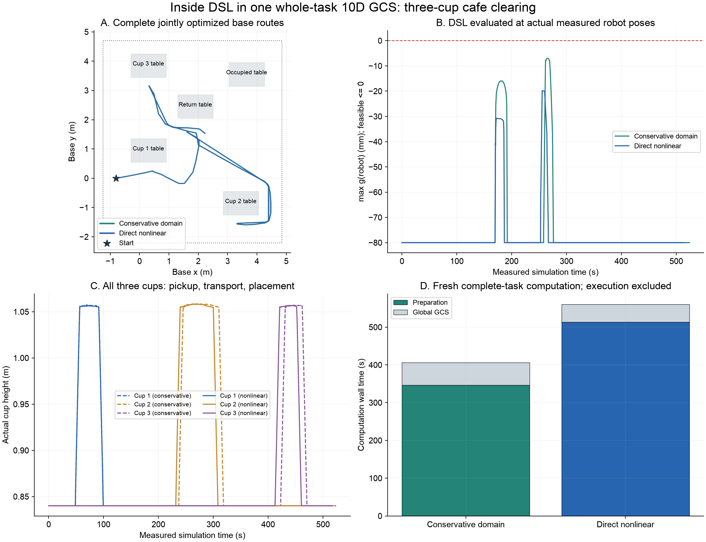

# Inside in the complete cafe task

The task clears three cups from three tables onto one return table. Each interface builds fresh regions and solves one task-wide graph in

\[
q=(x_b,y_b,\psi_b,a_1,\ldots,a_7)\in\mathbb R^{10}.
\]

Seven motion modes and six variable grasp/place configurations share this graph. Only the initial and final robot configurations are point constraints. Contact gates fix the gripper target pose through exact FK; the base and arm configurations at these gates remain variables. One convex GCS relaxation and a whole-task nonlinear restriction solve the spatial paths together. This does not mean a single convex optimization with no contact modes.

## Inputs and entry point

- [`inside_cafe.json`](../configs/inside_cafe.json): world-frame service workspace, robot `Inside`, held-cup `Inside`, common domain settings and execution speed.
- A common staged guide, scene snapshot, task specification and placement selection. The guide is an input to local region construction, not the reported final trajectory. Task order, grasp family and finger profiles are supplied.
- The scene uses the existing ReplicaCAD-derived cafe assets; prepare those as described in the README.

A small compressed [guide fixture](../configs/examples/inside_cafe_guide.json.gz) is included. It contains configuration data and a staged guide, not meshes, cached IRIS regions, a joint solution or execution results. Unpacking it performs no planning.

```bash
python -m pip install -e '.[dev,scene-assets]'
# Requires the pinned ReplicaCAD source assets under data/replicacad.
python scripts/prepare_inside_cafe_assets.py
python scripts/prepare_inside_cafe_guide.py --output outputs/inside_cafe_guide

LCM_DEFAULT_URL=memq:// OPENBLAS_NUM_THREADS=1 OMP_NUM_THREADS=1 \
python scripts/run_inside_cafe.py \
  --guide-run outputs/inside_cafe_guide \
  --output outputs/inside_cafe_run --execute

LCM_DEFAULT_URL=memq:// OPENBLAS_NUM_THREADS=1 OMP_NUM_THREADS=1 \
python scripts/report_inside_cafe.py \
  --run outputs/inside_cafe_run --output outputs/inside_cafe_report
```

Both methods use the same frozen scene, guide, predicates, joint limits, local-domain cap, human-access model, GCS objective and physical acceptance checks. The conservative branch can subdivide more where its semantic bound fails. Each method constructs its own cover and makes one task-level `SolvePath` call.

## Compiler and mode activation

[`semantic_compiler.py`](../src/semantic_compiler.py) uses the same support-function calculation as the fixed-base example, now with variable planar base coordinates. Calling `compile_predicates(..., base=None, gripper=...)` selects ten coordinates. Supplying a base preserves the previous seven-coordinate interface.

\[
g_{jk}(q)=n_k^Tt_j(q)+h_{S_j}(R_j(q)^Tn_k)+m-b_k\le0.
\]

The world-aligned planar base contributes exact projected translation coefficients and a yaw displacement bound to the conservative domain calculation. Vertical halfspaces are invariant to base x/y/yaw. Ancestor arm joints contribute the geometry-specific reach bounds. AutoDiff includes all ten variables.

[`inside_cafe.py`](../src/inside_cafe.py) compiles the robot predicate in every mode: 20 registered collision primitives × 6 faces = 120 rows. Held modes additionally activate `Inside(payload, service_workspace)`: six more rows for the registered welded planning payload. The payload predicate fails if no planning attachment exists. `robot` retains its previous meaning and does not silently change to include the payload.

The working area is a user constraint, separate from physical collision geometry. Its right boundary uses the task's original service-area limit, x = 4.85 m. The development run with x = 4.9 m left all nominal domains provably inside and was stopped rather than reported as an active nonlinear comparison.

## Two interfaces, including constraint presolve

For a candidate box \(D=[l,u]\), the compiler computes a row-wise bound

\[
g_j(q)\le g_j(c)+\sum_i L_{ji}h_i=\overline g_j(D),
\quad c=(l+u)/2,\ h=(u-l)/2.
\]

**Conservative domain:** require every bound to be at most `-1e-6 m`; reduce padding or subdivide if needed; supply the resulting domain to physical IRIS.

**Direct nonlinear:** retain the nominal domain. Rows with bound at most `-1e-6 m` are already redundant on that entire domain and can be omitted without changing its feasible set. The remaining rows are supplied to native IRIS through `sampled_iris_options.prog_with_additional_constraints`. This is constraint presolve, not a final path filter. Every row is still checked in the final independent audit. Records include both the certified count and the actual row indices sent to IRIS.

Human-access connectivity remains a separate evaluator with the same conservative witness bound in both branches. The new branch does not also impose the legacy room bound before IRIS: that would hide the distinction between the two Inside interfaces. This work does not claim that human-access connectivity is an `Inside` predicate.

## Contacts and execution

When the held cup is close to table support, an input domain is a contact patch rather than a collision-free IRIS region. Pairwise physical distance constraints are evaluated at its endpoints and midpoint in the full-task nonlinear restriction. Any Inside rows not already certified over that patch are added there too. Shared grasp/place gates receive the corresponding unproven Inside rows from both neighboring modes. These patches are counted separately in all reports.

The global solution is reconstructed without another stage planner or boundary IK solve. Independent checks cover region transitions, FK contacts, original spatial rules and the new Inside program. Then the task executes once in continuous free-body SAP simulation with actual grasp forces. Cups are not welded or reset during execution. Uniform execution retiming preserves the joint spatial solution.

[`audit_inside_cafe_execution.py`](../scripts/audit_inside_cafe_execution.py) checks every saved measured state using actual base, arm and finger positions. Cup containment uses actual free-body poses of all cups, including slip, rather than the planning attachment transform. The existing independent human-access audit checks both routes at every saved state.

## What the result means

The result page reports actual submitted nonlinear rows, accepted IRIS regions versus contact patches, preparation and whole-task GCS time, contact configuration changes, simultaneous base/arm motion, physical pickup/placement acceptance, measured containment and human-access checks.

Recorded run `inside_cafe_20261104_v3`:

| Measurement | Conservative domain | Direct nonlinear |
|---|---:|---:|
| Native IRIS regions + contact patches | 749 + 6 | 651 + 6 |
| Region growth and holdout checks | 332.40 s | 500.37 s |
| Total preparation, including region growth | 346.57 s | 513.17 s |
| One whole-task GCS call | 59.60 s | 47.27 s |
| Base path length | 21.004 m | 21.006 m |
| Physical cups accepted | 3 / 3 | 3 / 3 |
| Maximum final placement error | 1.188 mm | 1.105 mm |
| Saved measured states checked for Inside | 10,479 | 10,276 |
| Minimum measured robot Inside slack | 6.998 mm | 19.800 mm |
| Human-access violations / unexpected contacts | 0 / 0 | 0 / 0 |

The nonlinear branch submitted **221 scalar rows across 29 actual IRIS regions**; the other rows were certified redundant over their domains. It needed fewer regions and less GCS time, but more preparation time. This is one diagnostic task, not a statistical performance claim.

Both full spatial paths are optimized jointly. Their guide-local domains still keep most motion close to the staged seed. With thresholds of 1 mm base translation and 0.005 rad arm-vector change per segment, both have 19 simultaneous-motion segments, totaling approximately 0.048 m of base travel. This does not demonstrate broad coordinated exploration throughout the 21 m route.

Native IRIS/IPOPT subproblem warnings were recorded (48 / 50 warning messages in accepted regions); none triggered the probability-test-void rejection. The finite region checks, independent path checks and measured execution passed. Returned polytopes should not be presented as an absolute safety certificate.

The frozen [protocol](examples/inside_cafe/protocol.json), [comparison](examples/inside_cafe/summary.json), [actual nonlinear region example](examples/inside_cafe/nonlinear_region_example.json), and compressed [complete covers](examples/inside_cafe/covers.json.gz) are included. `covers.json.gz` is ordinary gzipped JSON containing every mode's compiler metadata and actual `A`, `b`, domain, submitted-row and timing records. Large physics traces and replay assets remain in local outputs; their hashes are in the [manifest](examples/inside_cafe/manifest.json).



Local guide coverage, supplied task order, first-order segments, fixed per-region durations, ideal planar base and static people remain limitations. Neither successful sampled execution nor native IRIS establishes continuous-time safety or global optimality. Proposal drafts remain local and excluded from Git.
