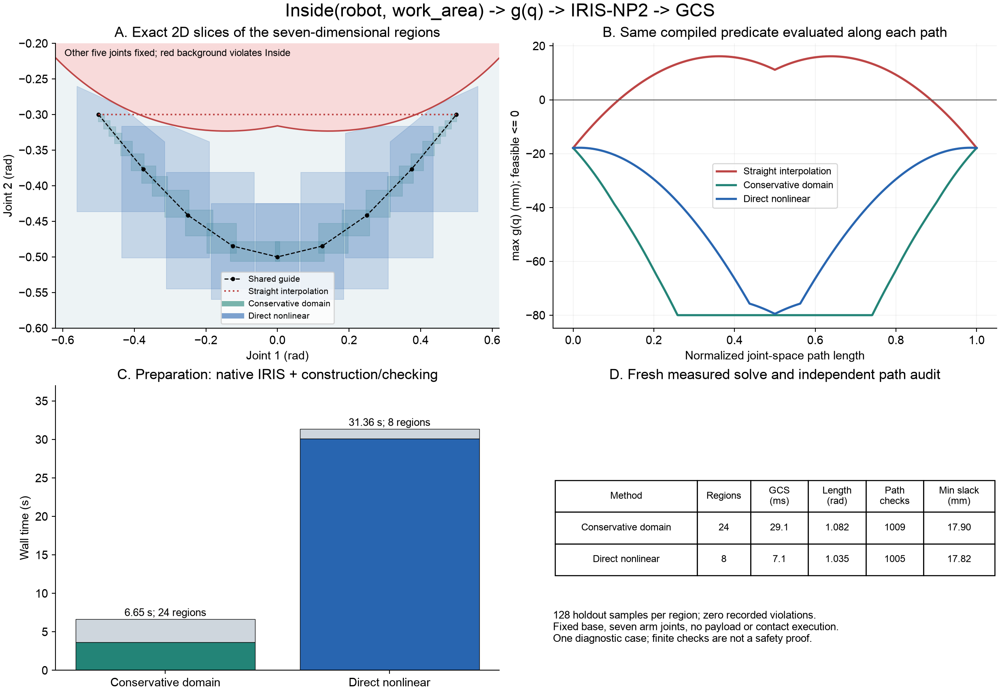

# Inside: one predicate, two IRIS interfaces

This example implements the DSL → checking program → IRIS → GCS part of the proposed framework. It uses a fixed base and seven arm joints. Natural-language parsing and the other DSL primitives are not implemented here.

## Read the code in this order

| Source | Input → output |
|---|---|
| [`semantic_dsl.py`](../src/semantic_dsl.py), `parse` | Versioned JSON → typed `Inside` predicates and normalized world-frame halfspaces. |
| [`semantic_compiler.py`](../src/semantic_compiler.py), `compile_predicates` | Predicates + registered robot collision geometry + fixed base/fingers → `CompiledInside`. |
| `CompiledInside.g`, `jacobian`, `box_upper_bound`, `to_program` | The same geometry calculation → point residuals, AutoDiff derivatives, conservative box bounds, Drake constraint program. |
| [`inside_iris_comparison.py`](../src/inside_iris_comparison.py), `solve_method` | Shared guide + compiler → conservative-domain or direct-nonlinear IRIS cover, including rejected attempts. |
| `solve_gcs` | Returned polyhedra + actual intersection edges + endpoints → seven-joint piecewise-linear trajectory. |
| `check_points` | Trajectory/region samples → independent whole-robot containment and native physical collision checks. |

## Predicate and compiled inequality

The complete input is [`inside_compiler_demo.json`](../configs/inside_compiler_demo.json). Its predicate is:

```json
{"id":"keep_robot_inside", "op":"Inside", "entity":"robot",
 "region":"work_area", "margin_m":0.02}
```

`work_area` is a world-frame box, from `[0.1,-1.4,-0.1]` to `[2.13,1.4,2.5]` metres. It is a user-imposed boundary, not an added physical obstacle. `robot` selects registered base, arm, and gripper collision geometry; a carried object is excluded.

Let the region be \(B=\{p:n_k^Tp\le b_k\}\), with unit normals. For collision shape \(S_j\), Drake FK gives its world pose \((R_j(q),t_j(q))\). The compiler emits

\[
g_{jk}(q)=n_k^Tt_j(q)+h_{S_j}(R_j(q)^Tn_k)+m-b_k\le0,
\qquad h_S(d)=\max_{v\in S}d^Tv.
\]

For a box, \(h_S(d)=\sum_i |d_i|s_i/2\); for a sphere, it is its radius. Cylinder and capsule support functions are also implemented. This checks the complete registered primitive against every region face. It does not check only the tool origin or substitute a world AABB. Unsupported shapes fail explicitly.

The example compiles 20 collision shapes × 6 faces = **120 scalar inequalities** in **7 variables**. Multiple predicates are conjoined. `compiled.json` associates every scalar inequality with its predicate, body, geometry, and region face. Positive `g` means a violation, in metres. Support functions have nonsmooth points; the callback supplies AutoDiff derivatives/subgradients and uses a small numerical guard at a cylinder pole.

## Interface A: constrain the input domain

For \(D=[l,u]\), define \(c=(l+u)/2\), \(h=(u-l)/2\). The compiler constructs per-geometry, per-ancestor-joint displacement coefficients \(L\), using downstream frame translations and collision-shape radii. Fixed-base rows have zero coefficients. A sufficient condition is

\[
g_j(q)\le g_j(c)+\sum_i L_{ji}h_i=\overline g_j(D),\qquad
\overline g_j(D)\le-10^{-6}\ \text{for every }j.
\]

The adapter reduces padding by bisection or subdivides a guide interval until this condition passes. It then calls native IRIS with that bounded domain and the physical collision checker. No additional semantic program is supplied in this branch.

## Interface B: give the inequalities to IRIS

The same compiler creates the native program:

```python
program = MathematicalProgram()
q = program.NewContinuousVariables(7, "q")
program.AddConstraint(compiled.g, -np.inf * np.ones(120), np.zeros(120), q)
options.sampled_iris_options.prog_with_additional_constraints = program
region = IrisNp2(checker, starting_ellipsoid, nominal_domain, options)
```

The real `to_program()` obtains the row count from the compiled predicates. Here the nominal domain retains its requested padding of `0.06 rad`; it need not satisfy the whole-box semantic bound. `options.parameterization` maps these **same seven coordinates** into full plant positions, fixing the base and fingers. Thus IRIS evaluates both physical collision and the supplied FK inequalities while constructing separating planes. The semantics are not deferred to a final path filter.

This is an existing Drake 1.57.0 interface. No Drake C++ core was changed. See the [native IRIS-NP2 implementation](https://github.com/RobotLocomotion/drake/blob/v1.57.0/planning/iris/iris_np2.cc) and its additional-constraint counterexample programs.

## GCS and acceptance

Each accepted output is \(P_i=\{q:A_iq\le b_i\}\). `IntersectsWith` determines directed adjacency; point regions encode start and goal. GCS solves for a first-order trajectory with joint-space length plus `0.05 × duration`, and joint velocities bounded by `±0.5 rad/s`.

Both branches use the identical coordinate transformation \(q=o+\operatorname{diag}(s)u\). Regions, endpoints, velocity bounds, and the path-length weight matrix are transformed together, preserving the original problem. Clarabel uses 500 iterations and `1e-6` gap/feasibility tolerances in both relaxation and restriction. Earlier raw-coordinate/tighter-tolerance attempts failed to converge; their local logs remain available. The reported results below are a fresh complete rerun after choosing the common settings.

Acceptance still requires `max g ≤ 1e-7 m` and native collision freedom. Each region receives 128 independent hit-and-run holdout samples. Paths are interpolated at maximum coordinate increments of `0.001 rad` and checked with a separate `WholeRobotRoomOracle` plus Drake's physical collision checker. A warning that voids the IRIS probabilistic test rejects the attempt. Rejected regions are subdivided within a finite budget.

## Recorded comparison

Same scene, endpoints, curved guide, requested padding cap, deterministic seed policy, IRIS settings, GCS objective, and audit thresholds. The guide is provided; guide discovery is outside this example. Conservative subdivision changes the number of IRIS calls.

| Measurement | Conservative domain | Direct nonlinear |
|---|---:|---:|
| Accepted regions / native calls | 24 / 24 | 8 / 8 |
| Rejected IRIS outputs | 0 | 0 |
| Native IRIS wall time | 3.630 s | 30.095 s |
| Preparation, including IRIS and region checks | 6.651 s | 31.363 s |
| GCS wall time | 29.10 ms | 7.11 ms |
| Total, including final path audit | 7.410 s | 32.100 s |
| Joint-space path length | 1.0817 rad | 1.0351 rad |
| Independently checked path samples | 1,009 | 1,005 |
| Minimum sampled semantic slack | 17.904 mm | 17.819 mm |

The straight interpolation between the same endpoints violates `Inside` by **16.153 mm** on the recorded sampling grid. Both planned paths pass. The nonlinear cover is less restrictive and yields a shorter path here, but native IRIS takes substantially longer. This single constructed diagnostic case does not establish a general performance advantage.

[`semantic_cut_witness.json`](examples/inside_compiler/semantic_cut_witness.json) records a configuration inside the first nominal domain that is physically collision-free but violates the right-finger containment inequality by **17.009 mm**. It is outside the returned nonlinear IRIS polytope. This distinguishes the semantic requirement from physical collision freedom; it is not a separate collision-only IRIS ablation.



Panel A is a true affine slice: the other five joints are fixed. It shows only intersections of the actual seven-dimensional regions with that slice. Full seven-dimensional GCS paths are evaluated in panel B rather than incorrectly overlaid as slice trajectories.

Frozen [protocol](examples/inside_compiler/protocol.json), [results](examples/inside_compiler/results.json), and per-method region/path/compiler JSON files are included. The protocol records source/scene hashes, Drake version, guide, and shared input hash. Timings are from one local serial rerun, not averages; preparation already includes native IRIS.

## Reproduce

Use the README environment, from the repository root:

```bash
LCM_DEFAULT_URL=memq:// OPENBLAS_NUM_THREADS=1 OMP_NUM_THREADS=1 \
python scripts/run_inside_iris_comparison.py --output outputs/inside_run

LCM_DEFAULT_URL=memq:// OPENBLAS_NUM_THREADS=1 OMP_NUM_THREADS=1 \
python scripts/report_inside_compiler.py \
  --run outputs/inside_run --output outputs/inside_report

LCM_DEFAULT_URL=memq:// python -m pytest -q tests/test_semantic_compiler.py
python -m http.server 7008
```

Open `/outputs/inside_report/index.html` on that server for comparison figures and both Drake replays. Replays are reparameterized to four seconds for viewing; they are kinematic reference playback, not contact execution. The scene and robot models need no external ReplicaCAD assets.

Scope: only `Inside`, world-frame convex regions, supported primitive collision shapes, fixed base/fingers, seven arm coordinates, no payload. No natural-language parser, moving region, whole-task DSL integration, global C-space coverage, or continuous-time safety proof is claimed. The existing cafe/ten-coordinate task planner remains a separate implementation. Proposal drafts remain local and ignored by Git.
